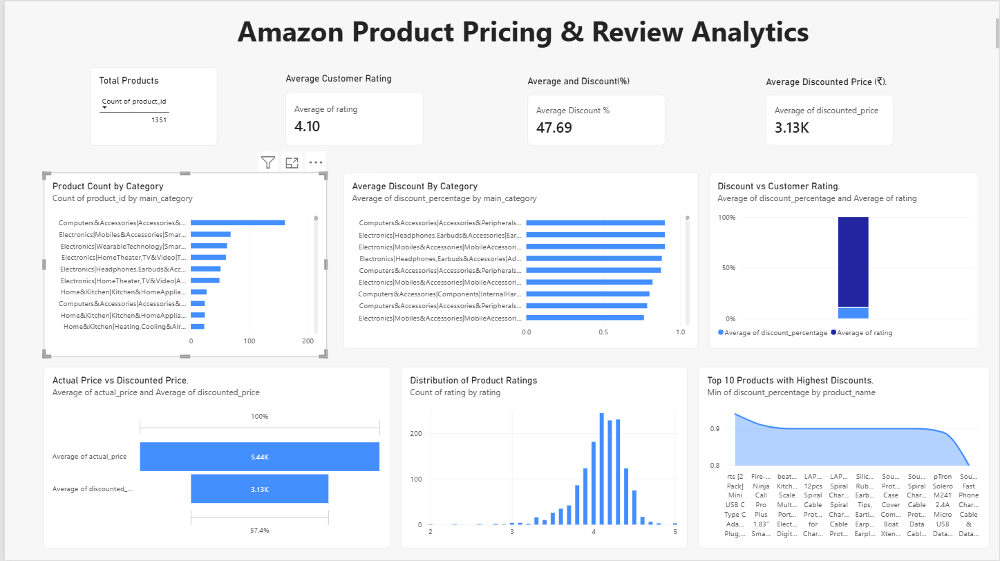

# Amazon Product Pricing & Review Analytics

## Project Overview
This project analyzes Amazon product listings to understand pricing patterns, discounts, product categories, and customer ratings. Python was used for exploratory data analysis, and Microsoft Power BI was used to build an interactive dashboard.

## Objectives
- Analyze product listings across categories.
- Compare actual and discounted prices.
- Identify products with the highest listed discounts.
- Understand customer rating distributions.
- Explore the relationship between discounts and ratings.

## Tools & Technologies
- Python
- Pandas, Matplotlib, Seaborn
- Google Colab
- Microsoft Power BI
- Power Query

## Key Findings
- Electronics has the highest number of product listings.
- Average listed discount: approximately 47.69%.
- Average customer rating: approximately 4.10 out of 5.
- Discount percentage and rating have a weak negative correlation of approximately -0.155.
- Some listings have discounts between 90% and 94%.

## Dashboard Features
- Total product count
- Average customer rating
- Average discount percentage
- Average discounted price
- Category-wise product analysis
- Rating distribution
- Price comparison
- Discount versus rating analysis
- Top discounted products

## Project Files
- `amazon_product_analysis.ipynb` — Python data cleaning, analysis, and visualizations.
- `Amazon_Product_Analytics.pbix` — Interactive Power BI dashboard.

## Dataset
[Amazon Sales Dataset on Kaggle](https://www.kaggle.com/datasets/karkavelrajaj/amazon-sales-dataset)

## Limitation
This dataset contains product listings and review information, not verified transaction records. Therefore, this project does not measure actual sales, revenue, or purchasing behavior.

## Dashboard Preview.

## Conclusion
This project demonstrates how Python and Power BI can be used to clean, analyze, and visualize product pricing and customer review data.

## Author
https://github.com/vidya-cse-dev
